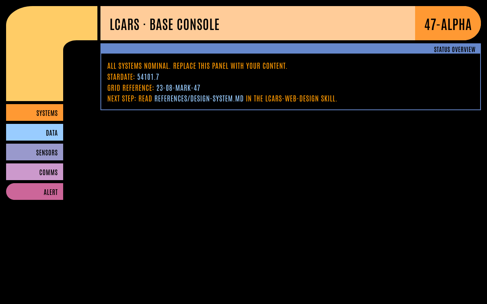
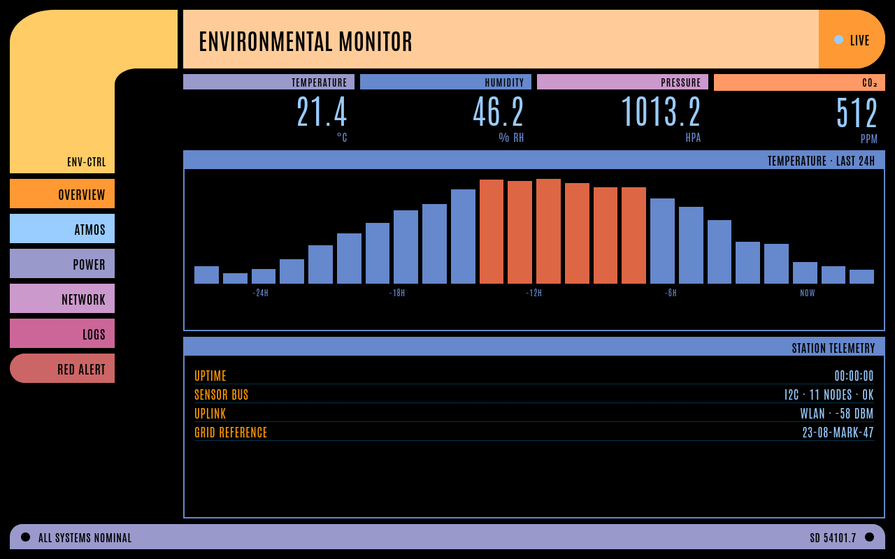

# LCARS Web Design

**Build authentic Star Trek: TNG LCARS interfaces for the web** — Okuda's design grammar, canon color palettes, pure-CSS elbow geometry, mechanical animations, and procedural audio chirps. No frameworks. No images. Just HTML/CSS/JS.



## What's Inside

| Path | Contents |
|------|----------|
| `SKILL.md` | The complete skill: grammar rules, workflow, pitfalls, verification checklist |
| `references/color-palettes.md` | Every canon palette: TNG 2357/2369/2375/2379, Picard, Lower Decks (+PADD), Nemesis Blue — as CSS custom properties |
| `references/design-system.md` | Okuda's design system: geometry math, layout patterns, typography scale, color semantics by department |
| `references/animations.md` | The five canon moves: boot sweep, steps() blinks, press flash, readout ticks, red alert + Web Audio beep snippets |
| `templates/lcars-base.html` | Minimal single-file starter — elbow + title bar + button column + panel |
| `templates/lcars-dashboard.html` | Full animated dashboard — live readouts, CSS bar chart, status footer, red-alert toggle, procedural beeps |
| `templates/lcars-components.css` | The complete component library: elbows (4 orientations), bars, buttons, panels, readouts, all color utilities, animation classes |
| `scripts/build_palette.py` | Emit CSS custom properties for any canon era |
| `docs/screenshots/` | Verified renders of both templates |

## Quick Start

```bash
# 1. Open the dashboard template in a browser — it just works
open templates/lcars-dashboard.html        # macOS
xdg-open templates/lcars-dashboard.html    # Linux

# 2. Generate a palette for your era
python3 scripts/build_palette.py 2369 > my-palette.css   # classic TNG
python3 scripts/build_palette.py picard                  # ST:P modern
python3 scripts/build_palette.py --list                  # all 8 palettes

# 3. Copy the base template and make it yours
cp templates/lcars-base.html my-console.html
```

## Design Principles (The Okuda Rules)

1. **Everything implies function** — no decoration, every block does something
2. **The frame is the interface** — L-shaped elbows + bars on black negative space
3. **Color is semantic** — gold = frame/primary, blue = data, purple = nav, red = alert
4. **Ultra-condensed uppercase type** — Antonio (web stand-in for Swiss 911 Ultra Compressed)
5. **Flat light** — no gradients, no shadows, no easing; panels snap, lights hard-blink



## Canon Color Sample (TNG 2369)

```css
--lcars-golden-tanoi: #FFCC66;   /* primary frame */
--lcars-neon-carrot:  #FF9933;   /* primary buttons */
--lcars-anakiwa:      #99CCFF;   /* data displays */
--lcars-lilac:        #CC99CC;   /* navigation */
--lcars-red-damask:   #DD6644;   /* alert only */
```

Full 31-color named palette plus 7 theme variants in `references/color-palettes.md`.

## The Elbow, Mathematically

The signature L-shape is a rounded rect with an inner black cutout — no images, no SVG:

```css
.lcars-elbow { border-top-left-radius: 70px 50px; }        /* outer: elliptical */
.lcars-elbow::after {                                       /* inner cutout */
  left: var(--col-w); top: var(--bar-h); right: 0; bottom: 0;
  background: #000; border-top-left-radius: 35px 25px;      /* ~half of outer */
}
```

Geometry tokens (`--bar-h`, `--col-w`) scale the whole frame proportionally — verified rendering across desktop and kiosk sizes.

## Sound Without Audio Files

Procedural Web Audio chirps (a 1600Hz sine burst with a fast pitch drop reads as an authentic panel beep):

```js
lcarsBeep(1600, 0.05);  // standard button chirp
lcarsBeep(900, 0.09);   // alert bonk
```

## Heritage

Design language by **Michael Okuda** (1987). Palette data verified against the trekcolors canon set and thelcars.com theme guide. This repo is a fan-made design toolkit for educational/demonstration purposes — Star Trek is a trademark of Paramount; no affiliation.

## License

MIT — see the show, build the future.
